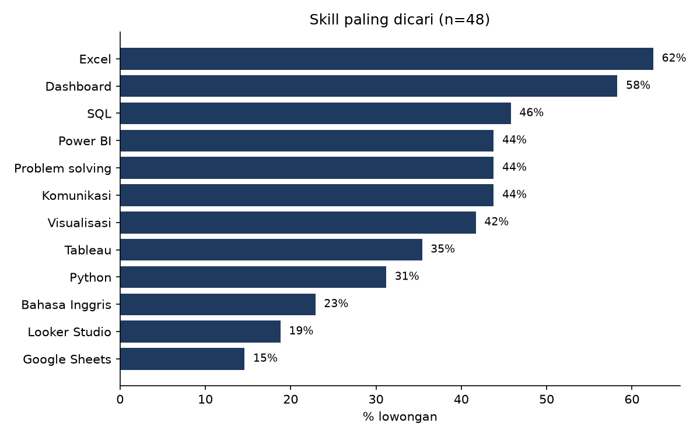
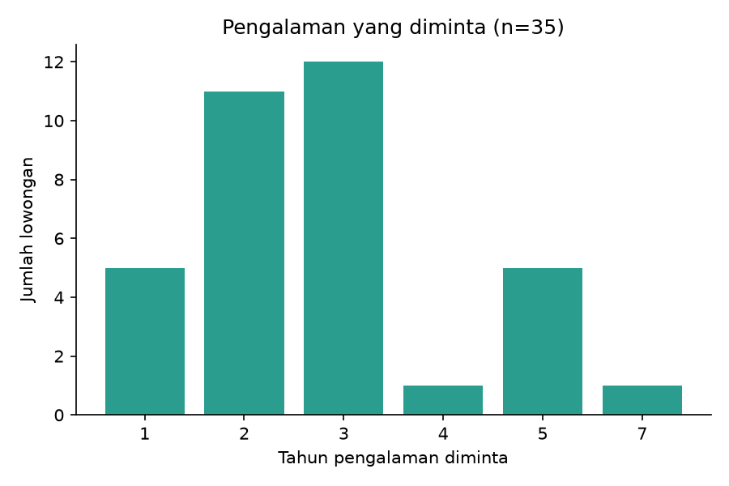

# Requirement Data Analyst di Indonesia: Studi Awal dari Lowongan Jobstreet

Studi awal untuk mengetahui skill, pengalaman, dan kisaran gaji yang diminta untuk posisi Data Analyst di Indonesia, berdasarkan 48 lowongan di Jobstreet Indonesia (data diambil Oktober 2026).

**Laporan online:** [Hasil analisa](https://bikacu.github.io/data-analyst-job-scraper/) | [Catatan proses](https://bikacu.github.io/data-analyst-job-scraper/proses.html)

## Temuan utama

| Skill | % lowongan |
|---|---|
| Excel | 62,5% |
| Dashboard | 58,3% |
| SQL | 45,8% |
| Power BI | 43,8% |
| Tableau | 35,4% |
| Python | 31,2% |

- **Pengalaman:** 23 dari 35 lowongan yang menyebut lama pengalaman meminta 2-3 tahun; hanya 4 dari 48 lowongan menyebut fresh graduate.
- **Gaji:** median batas bawah Rp5,75 jt dan batas atas Rp7,5 jt per bulan (hanya 9 lowongan yang mencantumkan gaji).
- **Lokasi:** minimal 28 dari 48 lowongan berada di wilayah Jakarta.




## Metode

1. Mengambil hasil pencarian Jobstreet Indonesia (3 keyword, 319 lowongan) memakai Playwright.
2. Menyaring berdasarkan judul menjadi 51 lowongan data analyst.
3. Mengambil deskripsi lengkap tiap lowongan, membuang iklan duplikat (48 lowongan dianalisa).
4. Menghitung frekuensi skill dengan keyword matching (regex), dihitung per lowongan (muncul atau tidak).

## Struktur repo

| File | Fungsi |
|---|---|
| `scrape_list2.py` | Mengambil daftar lowongan dari hasil pencarian |
| `scrape_detail2.py` | Menyaring judul dan mengambil deskripsi lengkap |
| `check_filter.py` | Mengecek judul yang terbuang oleh filter |
| `analysis.py` | Menghitung skill, pengalaman, gaji, lalu membuat grafik |
| `skill_freq.csv` | Hasil agregat frekuensi skill |
| `docs/` | Laporan hasil analisa (`index.html`) dan catatan proses (`proses.html`), tampil lewat GitHub Pages |

## Cara menjalankan

```bash
python -m venv venv
venv\Scripts\activate
pip install -r requirements.txt
playwright install chromium

python scrape_list2.py
python scrape_detail2.py
python analysis.py
```

## Keterbatasan

- Sampel kecil: 48 lowongan, hanya 9 dengan gaji.
- Satu platform, halaman hasil pencarian teratas, satu waktu; didominasi Jakarta.
- Keyword matching: skill yang disebut belum tentu wajib (bisa sekadar nilai tambah).
- Hasil ini gambaran awal, bukan statistik pasar kerja.

## Catatan etika dan data

Data mentah (judul, deskripsi, dan nama perusahaan dari Jobstreet) **tidak disertakan** di repo ini karena merupakan konten pihak lain. Repo hanya berisi kode dan hasil agregat. Pengambilan data dilakukan dalam skala kecil dengan jeda antar halaman, dan proses dihentikan jika terblokir. Jika ingin mereproduksi, jalankan skrip dengan memperhatikan ketentuan layanan (ToS) Jobstreet.